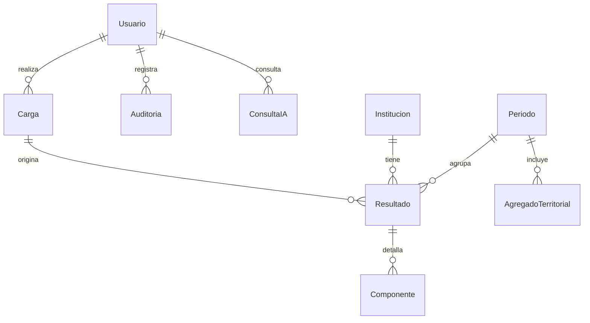

# SDD · Planificación y arquitectura

## Capas

React/TypeScript (presentación) → Fetch HTTPS + cookies de sesión y CSRF → Django REST Framework (control de acceso, validación y lógica) → PostgreSQL (persistencia). Servicio ETL pandas analiza XLS/XLSX/CSV antes de la transacción. Ollama local solo recibe un contexto estructurado desde Django; no conecta con PostgreSQL.

## Diagrama ER conceptual

## Scrum compatible con SDD

- Sprint 1: definir alcance, arquitectura, especificaciones y criterios de aceptación.
- Sprint 2: autenticación, roles, solicitudes, PostgreSQL.
- Sprint 3: ETL validado sobre el verdadero libro oficial ICFES.
- Sprint 4: consulta, indicadores y diez gráficas.
- Sprint 5: informes, IA, idioma, voz y accesibilidad.
- Sprint 6: pruebas, seguridad, despliegue y evidencia de sustentación.

Distribución indicativa: integrante A, frontend/UX/gráficas/localización/voz (50%); integrante B, Django/PostgreSQL/ETL/IA (50%). Ambas realizan diseño, revisión cruzada, pruebas y documentación; estas proporciones son metas, no horas medidas.

## Riesgos

Formatos oficiales variables; clasificación DANE; permisos institucionales; exposición de información sensible; consumo de memoria en Excel; indisponibilidad de Ollama; escasez de datos históricos; compatibilidad Windows.
